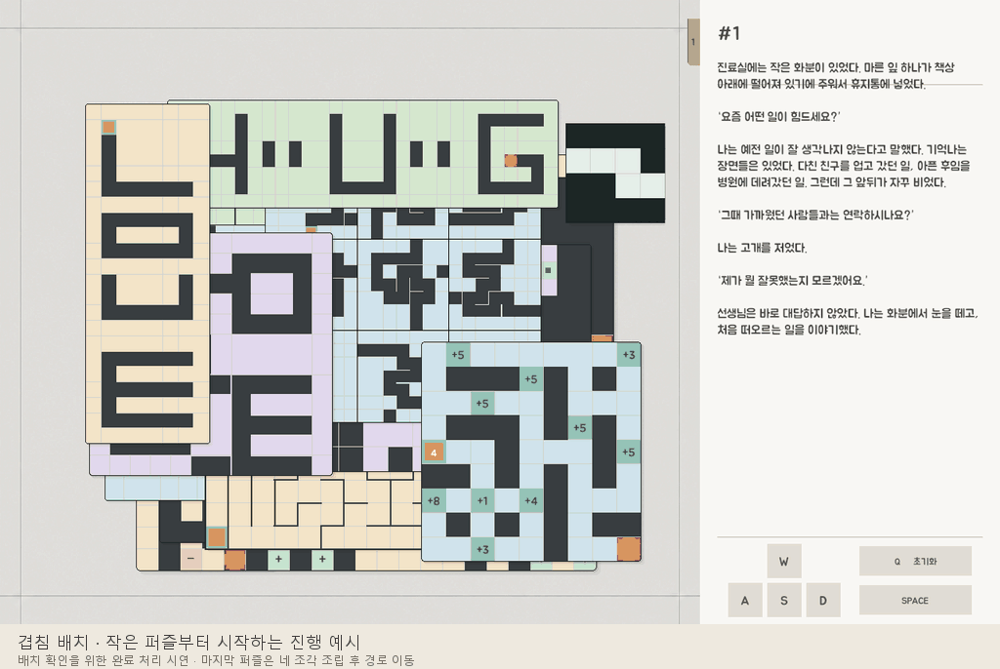

# MemoryProtocol

겹쳐진 미로를 옮겨 숨은 길을 찾고, 퍼즐을 풀어 가려진 문장을 복원하는 2D 퍼즐 게임입니다.

Unity 6000.3.18f1 · C# · Windows PC 대상 · 1스테이지 프로토타입

이 저장소는 포트폴리오용 코드 리뷰 자료입니다. 아래 설명에서 각 시스템을 담당하는 C# 파일을 열어볼 수 있습니다.

## 게임 흐름

노출된 퍼즐 창 선택 및 이동 → 미로 풀이 → 해결한 창 제거 → 아래 창이나 조립 조각 발견

종이를 접고 펼치면 통로의 연결이 달라지고, 중력 미로에서는 미로 자체를 돌려 공의 낙하 경로를 만듭니다. 해결한 퍼즐은 이야기 탭을 열거나 가려진 문장을 복원하는 데에도 쓰입니다.

## 개발 환경

| 구분 | 내용 |
| --- | --- |
| 엔진 | Unity 6000.3.18f1 |
| 언어 | C# |
| UI | Unity UI, RectTransform |
| 데이터 | ScriptableObject, Inspector 직렬화 |
| 검증 | Unity Play 모드, 미로 경로 및 조각 배치 검사 |
| 협업 도구 | Git, GitHub, Codex |

## 주요 구현 기술

### 1. 창의 겹침과 입력 처리

창을 잡아 옮기면 다른 창과 실제로 겹치는 영역도 바뀝니다. 창의 표시 순서는 유지하고, 포인터로 선택한 퍼즐에만 키보드 조작을 전달합니다. 창 이동과 완료 상태는 퍼즐 창 컴포넌트에서 관리합니다.

- [창의 이동과 완료 상태](Scripts/PuzzleWindow.cs)
- [입력 대상 선택](Scripts/PuzzleInputSelection.cs)
- [선택한 퍼즐에 입력 전달](Scripts/SharedPuzzleControls.cs)

**코드에서 볼 부분**  
[`PuzzleWindow.MoveTo`](Scripts/PuzzleWindow.cs#L107)는 창의 좌표를 이동 영역 안으로 제한합니다. [`SharedPuzzleControls.Select`](Scripts/SharedPuzzleControls.cs#L28)는 이후 키보드 입력을 받을 퍼즐을 설정합니다. 위치 변경과 입력 대상 전환을 각각 읽어볼 수 있습니다.

### 2. 한 칸 이동과 홀드 반복

일반 미로는 키를 한 번 누르면 한 칸 이동하고, 누르고 있으면 일정 간격으로 반복합니다. 이동 중 들어온 방향을 처리하는 입력 상태와 실제 칸 사이를 보간하는 이동 로직을 나눴습니다. 퍼즐은 다음 칸으로 이동할 수 있는지와 칸의 화면 위치를 제공합니다.

- [첫 입력, 반복, 방향 전환](Scripts/MazeStepInput.cs)
- [이동 시간 설정과 MazePathMotor](Scripts/MazeMovementSettings.cs)

**코드에서 볼 부분**  
[`MazeStepInput.Advance`](Scripts/MazeStepInput.cs#L32)는 누르고 있는 방향과 반복 타이머를 바탕으로 다음 이동 입력을 결정합니다. [`MazePathMotor.AdvanceSteps`](Scripts/MazeMovementSettings.cs#L79)는 진행 중인 이동을 갱신하고, 다음 입력이 들어오면 퍼즐의 경로 규칙을 적용합니다. 두 메서드를 함께 보면 키를 놓았을 때 이동 중인 한 칸을 마무리하는 흐름을 확인할 수 있습니다.

### 3. 조각을 끼워 완성하는 미로

다른 창 아래에 가려진 네 조각을 찾아 빈칸에 끼웁니다. 빈칸에 들어간 조각의 실제 통로를 사용하므로 어떤 위치에 끼우는지에 따라 연결이 달라집니다. 제작 검증에서는 완전 배치 24개와 부분 배치 185개를 탐색해 출구까지 이어지는 배치 하나와 단순 경로 하나를 확인했습니다.

- [조립 퍼즐의 이동과 연결](Scripts/AssemblyMazePuzzle.cs)
- [본판과 조각의 결합 처리](Scripts/AssemblyMazeSocketBoard.cs)

**코드에서 볼 부분**  
[`AssemblyMazePuzzle.TryStep`](Scripts/AssemblyMazePuzzle.cs#L157)은 현재 칸과 이동 방향으로 다음 칸의 진입을 판단합니다. 조립 본판에서 [`SocketCanOccupy`](Scripts/AssemblyMazeSocketBoard.cs#L80)는 빈칸에 끼워진 조각의 통로를 검사합니다. 조각을 다른 슬롯에 놓으면 이동 판정에도 그 슬롯의 조각이 반영됩니다.

### 4. 퍼즐 완료와 이야기 공개

서로 다른 퍼즐의 첫 완료를 기록하고, 이야기 보상은 대기열 순서로 처리합니다. 기억 조각이 대상 탭에 도착한 뒤 새 탭을 열거나 낙서를 지웁니다. 플레이어가 읽고 있던 탭과 스크롤 위치를 유지합니다.

- [보상 등록과 대기열](Scripts/StoryProgression.cs)
- [퍼즐 창 완료 연출](Scripts/PuzzleClearEffect.cs)

**코드에서 볼 부분**  
[`StoryProgression.Enqueue`](Scripts/StoryProgression.cs#L57)는 처음 해결한 창만 보상 처리 대기열에 넣습니다. [`StoryProgression.Advance`](Scripts/StoryProgression.cs#L66)는 대기열을 진행하며 현재 기억 조각의 도착 시점에 연결된 보상을 적용합니다.

## 코드 탐색

| 주요 파일 | 담당 기능 |
| --- | --- |
| [PuzzleWindow](Scripts/PuzzleWindow.cs) · [PuzzleInputSelection](Scripts/PuzzleInputSelection.cs) · [SharedPuzzleControls](Scripts/SharedPuzzleControls.cs) | 창의 이동과 제거, 퍼즐 선택, 키보드 입력 전달 |
| [MazeStepInput](Scripts/MazeStepInput.cs) · [MazeMovementSettings](Scripts/MazeMovementSettings.cs) | 한 칸 입력과 홀드 반복, 이동 보간, 공통 시간 설정 |
| [AssemblyMazePuzzle](Scripts/AssemblyMazePuzzle.cs) · [AssemblyMazeSocketBoard](Scripts/AssemblyMazeSocketBoard.cs) | 조각과 빈칸 결합, 조립 상태에 따른 통로 판정 |
| [StoryProgression](Scripts/StoryProgression.cs) · [PuzzleClearEffect](Scripts/PuzzleClearEffect.cs) | 완료 연출, 이야기 보상 순서와 공개 시점 |

## 개발 방식

Codex와 협업해 플레이 규칙과 입력 조건을 정리하고, Unity에서 창이 겹친 상태의 선택·이동·제거를 확인하며 구현을 다듬었습니다. 개별 퍼즐은 제작 씬에서 조작과 정답 경로를 검증하고, 게임 씬에서는 F7 메뉴로 개별 퍼즐과 전체 배치를 확인했습니다.

## 공개 범위

포트폴리오에서 설명하는 기능의 C# 파일을 작업본에서 골라 수록했습니다. Unity 씬, 프리팹, 데이터 에셋, 외부 패키지, 전체 개발 이력은 공개본에서 제외했습니다. 코드는 원본 프로젝트의 컴포넌트와 씬 참조에 의존하므로 공개본은 코드 열람용입니다.
